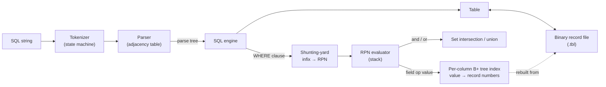

# Mini_Database

A small relational database engine written from scratch in C++17. It parses a
subset of SQL, stores tables as fixed-width binary records on disk, and keeps a
**B+ tree index on every column**. The index structures and the parser's
containers (B+ tree, map / multimap, stack, queue) are implemented here rather
than taken from the STL.

```text
sql> select first, last from employee where (dep = CS or dep = HR) and year < 2016
    record          first           last
         0           Jack        Johnson
         1             Bo           Yang
```

## Features

- **SQL subset:** `make table` / `create table`, `insert into`, and `select`
  with column projection and `WHERE` clauses using `= < > <= >=`, `and`, `or`,
  and parentheses
- **Expression evaluation:** a hand-written tokenizer (finite state machine)
  feeds a parser, then the **shunting-yard algorithm** converts the `WHERE`
  clause to **Reverse Polish Notation**, which is evaluated with a stack
- **Indexing:** each column has a B+ tree multimap from value to record
  numbers; `and` / `or` become set intersection / union of sorted record-number
  lists
- **Persistence:** records are written as fixed-width binary blocks; indices
  are rebuilt from the file when a table is reopened, so data survives restarts
- **Tests:** GoogleTest suites, including randomized property tests that check
  the B+ tree against `std::set` after every operation

## Architecture



| Module | Path | Role |
|---|---|---|
| Tokenizer | `includes/tokenizer/` | Table-driven state machine splitting input into words, numbers, quoted strings and operators |
| Parser | `includes/parser/` | Validates command grammar with a state transition table and builds a parse tree (`command`, `table_name`, `fields`, `where`, ...) |
| Shunting-yard / RPN | `includes/shunting_yard/`, `includes/rpn/` | Operator precedence (`relational > and > or`), parentheses, postfix evaluation |
| B+ tree | `includes/bplustree/` | Templated B+ tree with linked leaves, plus `Map` and `MultiMap` built on top of it |
| Table | `includes/table/` | Record insertion, per-column indices, `select`, condition evaluation |
| Binary files | `includes/binary_files/` | Fixed-width record I/O (`FileRecord`) |
| Stack / Queue | `includes/stack/`, `includes/queue/` | Linked-list based containers used by the parser and evaluator |

### B+ tree design

- Order is set by `MINIMUM` (default 1, i.e. a 2-3 tree; raise it for wider
  nodes). Inner nodes hold copies of separator keys; **all elements live in the
  leaves**, which are linked so a range scan is a linked-list walk.
- Insertion uses the *loose insert, then fix excess* approach: a child can
  temporarily hold `MAXIMUM + 1` keys, and the parent splits it on the way back
  up.
- Removal uses *loose remove, then fix shortage*: a child that drops below
  `MINIMUM` first borrows from a sibling (`transfer_left` / `transfer_right`)
  and otherwise merges with it (`merge_with_next_subset`).

## Build and run

Requirements: CMake 3.14 or newer and a C++17 compiler (GCC, Clang, or MSVC).
GoogleTest is downloaded automatically.

```bash
git clone https://github.com/Jean716/Mini_Database.git
cd Mini_Database
cmake -S . -B build
cmake --build build -j

# Run the demo script
cd build
./bin/main < ../examples/demo.sql

# Or open an interactive shell (add --verbose to see the engine's trace)
./bin/main
```

Tables are created in the **current working directory** as `<name>.tbl`
(records) and `<name>_fields.txt` (schema), with a `_tables.txt` catalog. These
files are ignored by git.

### Supported syntax

```sql
make table employee fields last, first, dep, salary, year
insert into employee values Johnson, "Jimmy", Chemistry, 140000, 2018
select * from employee
select first, last from employee where dep = CS
select * from employee where last >= J and (dep = CS or dep = HR)
```

Values containing spaces must be quoted (`"Mary Ann"`). Lines starting with
`--` are treated as comments by the shell.

## Testing

```bash
cd build
ctest --output-on-failure
```

| Suite | What it checks |
|---|---|
| `basic_test` | End-to-end SQL: creates two tables, runs 9 `select` queries, and asserts the exact set of matching records for each |
| `bplustree_test` | Randomized **property tests**: 5 seeds × 3,000 interleaved inserts and removes, mirrored on `std::set`. After every step the tree must pass its structural invariant check (`is_valid`), and at the end its in-order contents and `size()` must equal the model. Also covers bounds, full deletion, and deep copies |

`examples/bplustree_demo.cpp` builds to `bin/bplustree_demo` and prints tree
shapes during copy and modification, which helps when stepping through the code.

## Roadmap

- Typed columns with numeric comparison (values are currently compared as strings)
- Index-based conditions: `=` via `find`, ranges via `lower_bound` / `upper_bound`, for O(log n + k) instead of scanning every key
- `delete` / `update` / `drop` commands (the B+ tree already supports removal)
- `not` operator
- Variable-width records (currently up to 10 fields of 255 characters each)

## Background

Built as the final project for CS 8 at Pasadena City College; the CMake
skeleton and test harness layout follow the course template. After the course,
the test suites were rewritten to assert real results and the interactive shell
was added.
